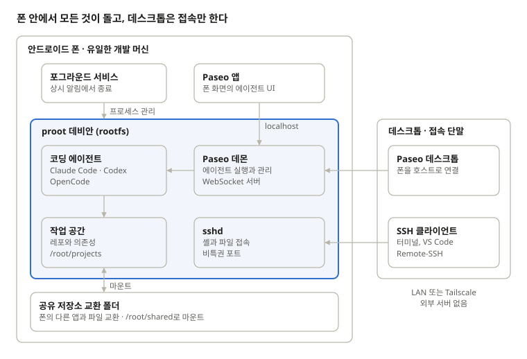

# 폰을 개발 머신으로: 기획서

Oct 30, 2026 · @WONYOUNG HUR

## 개요와 목표

안드로이드 폰 하나를 유일한 개발 머신으로 만드는 앱을 만든다. 폰 안에 루트 없이 리눅스를 올리고, 그 위에서 코딩 에이전트를 돌리며, Paseo 수준의 에이전트 UI로 감싼다. 데스크톱은 개발 머신이 아니라 폰에 접속하는 단말이다.

Kai는 폰에 리눅스를 올리는 문제를 풀었지만 사용자가 마주하는 건 터미널이다. Paseo는 에이전트를 다루는 경험이 훌륭하지만 데몬이 돌아갈 별도의 컴퓨터가 필요하다. 이 앱은 Kai의 리눅스 레이어와 Paseo의 데몬·앱을 합쳐 두 빈자리를 함께 메운다.

개인용이다. 배포는 GitHub Releases로만 하고, 대중 사용자를 위한 배려보다 내가 원하는 작업 환경을 만드는 데 집중한다.

## 설계 원칙

- **폰이 유일한 머신.** 별도 서버, 클라우드 호스트, 제3자 릴레이를 두지 않는다. 모든 연산과 데이터는 폰 안에 있다.
- **Paseo는 최소한으로 수정.** Paseo는 빠르게 변하므로 업스트림을 계속 따라갈 수 있어야 한다. 새 기능은 독립된 모듈로 붙이고, 본체 수정은 꼭 필요한 접점에만 한정한다.
- **이미 있는 것을 재사용.** 리눅스 레이어는 Kai, 데몬과 에이전트 연동은 Paseo의 것을 가져온다. 새로 짜는 건 둘을 잇는 접착 코드다.
- **작업 공간은 온전한 리눅스 파일시스템에.** 레포와 의존성은 rootfs 안에 두고, 안드로이드 공유 저장소는 파일 교환 용도로만 쓴다.
- **개인용답게 단순하게.** 스토어 정책, 저사양 기기, 초보자용 안내는 고려하지 않는다. 기기 설정 한 번으로 해결되는 문제는 앱이 우회하지 않는다.

## 구조

폰의 Paseo 앱은 localhost로, 데스크톱은 LAN이나 Tailscale로 같은 데몬과 sshd에 붙는다. 폰 안과 밖이 같은 호스트를 보는 구조라 Paseo 쪽 연결 방식은 그대로 쓴다.

## 범위

1차 목표는 폰 하나로 세 에이전트를 실제 개발에 쓸 수 있는 상태다.

- **리눅스 환경.** 루트 없이 proot로 데비안을 올린다. 설치와 업데이트는 앱이 관리한다.
- **에이전트.** Claude Code, Codex, OpenCode. 셋 모두 Paseo가 이미 지원하므로 연동 작업이 아니라 "폰에서 실제로 도는지"가 과제다.
- **상시 실행.** Paseo 데몬과 sshd를 기본으로 띄우고 포그라운드 서비스로 유지한다. 상시 알림에서 상태와 접속 주소를 보여주고, 종료할 수 있게 한다. 화면이 꺼진 동안에도 작업이 이어지도록 하는 옵션을 둔다.
- **폰 안의 UI.** Paseo 앱이 폰 안의 데몬을 "이 기기" 호스트로 자동 인식한다. 별도 페어링 과정이 없어야 한다.
- **데스크톱 접근.** 데스크톱 Paseo 앱이 폰을 호스트로 붙을 수 있고, SSH로 폰의 리눅스에 직접 들어갈 수 있다(VS Code Remote-SSH 포함). 경로는 LAN, 원하면 Tailscale.
- **교환 폴더.** 공유 저장소의 전용 폴더 하나를 리눅스 안에 마운트해, 폰의 다른 앱과 파일을 주고받는다. 에이전트들도 이 규칙을 알도록 전역 지침에 적어 둔다.

## 하지 않을 것

- 외부 서버, 클라우드, Paseo 릴레이를 통한 원격 접속
- 알파인 등 데비안 외 배포판 선택지
- 무거운 빌드(안드로이드 Gradle 빌드 등)를 폰에서 감당하는 것
- 공유 저장소에서의 레포 작업, 양방향 동기화
- Play 스토어 배포와 그에 따른 정책 대응
- 일반 사용자를 위한 친절한 온보딩

## 먼저 검증할 것과 리스크

코드를 합치기 전에, 기존 도구(Termux와 proot-distro)만으로 핵심 가설이 성립하는지 확인한다. 이게 안 되면 설계가 바뀐다.

- **세 에이전트가 proot 데비안에서 도는가.** OpenCode가 가장 불확실하므로 먼저 본다.
- **Paseo 데몬이 proot 안에서 안정적으로 도는가.** 폰의 Paseo 앱과 데스크톱 Paseo 앱이 모두 붙는지 확인한다.
- **실사용 속도.** proot 오버헤드 때문에 git, 패키지 설치 같은 파일 작업이 체감상 견딜 만한지 본다.

그 밖에 알고 가야 할 리스크는 세 가지다. 안드로이드의 phantom process killer가 자식 프로세스를 죽일 수 있다(기기 설정으로 끈다는 전제). 백그라운드 장시간 실행은 배터리와 발열 부담이 있다. Paseo 업스트림 변경이 접점 패치와 충돌할 수 있다.

## 진행 순서

1. **가설 검증.** 위 검증 항목을 기존 도구로 확인한다.
2. **리눅스 레이어 이식.** Kai의 리눅스 코드와 proot 빌드를 Paseo 앱에 독립 모듈로 붙인다.
3. **상시 실행.** 데몬과 sshd를 포그라운드 서비스로 띄우고, 알림에서 상태 확인과 종료를 한다.
4. **폰 안의 연결.** Paseo 앱이 내장 데몬을 자동으로 호스트로 인식하게 한다. Paseo 본체에 손대는 거의 유일한 지점이다.
5. **데스크톱 연결과 교환 폴더.** 데스크톱 Paseo와 SSH 접속, 공유 저장소 교환 폴더를 갖춘다.
6. **일상 사용.** 실제로 써 보면서 불편한 점을 다듬는다.

## 참고 자료

- [Kai](https://github.com/SimonSchubert/Kai): 리눅스 레이어의 출처. 안드로이드용 proot 빌드, rootfs 설치, proot 실행과 셸 세션 관리 코드를 참고한다.
- [Paseo](https://github.com/getpaseo/paseo): 데몬, 앱, 에이전트 연동의 출처. 아키텍처와 프로바이더 문서가 출발점이다.
- [termux/proot](https://github.com/termux/proot), [termux/proot-distro](https://github.com/termux/proot-distro): proot 동작과 알려진 문제의 기준점.
